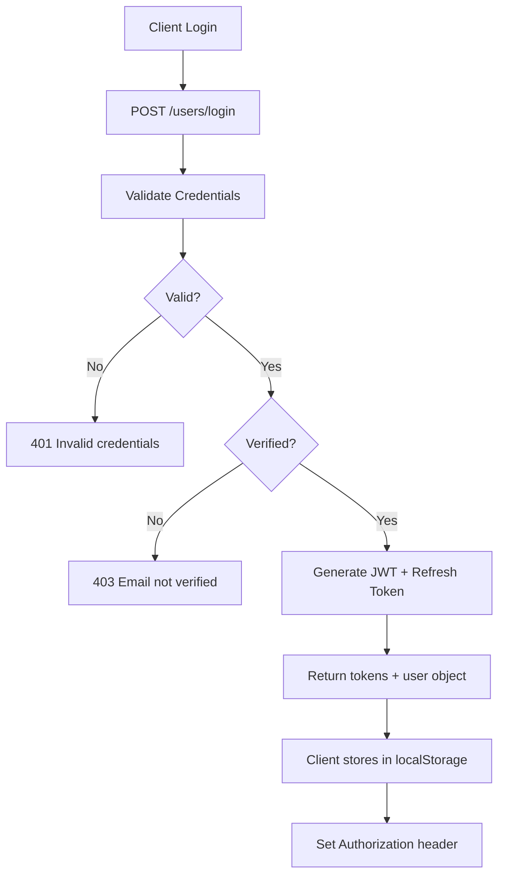
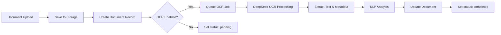

# Projectena - Complete System Architecture Analysis

> **Generated:** November 1, 2025  
> **Purpose:** Comprehensive system analysis for continued development

---

## 📋 Table of Contents

1. [System Overview](#system-overview)
2. [Architecture Layers](#architecture-layers)
3. [Data Models](#data-models)
4. [Authentication & Authorization](#authentication--authorization)
5. [API Endpoints](#api-endpoints)
6. [Frontend Architecture](#frontend-architecture)
7. 
8. [Security Implementation](#security-implementation)
9. [Development Recommendations](#development-recommendations)
10. [Missing Components](#missing-components)

---

## 🏗️ System Overview

**Projectena** is a multi-tenant document management system with OCR capabilities built on the MERN stack with enterprise-grade features.

### Tech Stack
```yaml
Backend:
  - Runtime: Node.js
  - Framework: Express.js
  - Database: MongoDB (Mongoose ODM)
  - Auth: JWT + bcryptjs
  - Email: Nodemailer
  
Frontend:
  - Framework: React 18
  - Build Tool: Vite
  - Routing: React Router v7
  - HTTP Client: Axios with interceptors
```

### Architecture Pattern
- **Pattern:** Layered Architecture (MVC + Repository Pattern)
- **Multi-tenancy:** Company → Department → User hierarchy
- **Access Control:** Role-Based Access Control (RBAC)
- **Data Strategy:** Soft deletes, optimistic locking

---

## 🔄 Architecture Layers

### 1. **Entry Point Layer**
```
server.js
├── Environment configuration (.env)
├── MongoDB connection
└── Express app initialization
    └── app.js (main Express app)
```

### 2. **Routing Layer** (`/Routes`)
```
Routes/
├── userRoutes.js       # User management & auth
├── documentRoutes.js   # Document CRUD
├── companyRoutes.js    # Company management
├── departmentRoutes.js # Department management
└── folderRoutes.js     # Folder hierarchy
```

### 3. **Controller Layer** (`/Controllers`)
```
Controllers/
├── UserController.js       # User operations
├── DokumentController.js   # Document operations
├── CompanyController.js    # Company operations
├── DepartmentController.js # Department operations
└── FolderController.js     # Folder operations
```

**Responsibilities:**
- Request validation
- Response formatting
- Error handling
- HTTP status management

### 4. **Service Layer** (`/services`)
```
services/
├── authService.js       # Auth utilities (JWT, hashing)
├── userService.js       # User business logic
├── documentService.js   # Document business logic
├── companyService.js    # Company business logic
├── departmentService.js # Department business logic
├── folderService.js     # Folder business logic
└── emailService.js      # Email notifications
```

**Responsibilities:**
- Business logic
- Access control filtering
- Data transformation
- Cross-entity operations

### 5. **Repository Layer** (`/repositories`)
```
repositories/
├── userRepository.js       # User data access
├── documentRepository.js   # Document data access
├── companyRepository.js    # Company data access
├── departmentRepository.js # Department data access
└── folderRepository.js     # Folder data access
```

**Responsibilities:**
- Direct database operations
- Query building
- Data sanitization
- Pagination handling

### 6. **Model Layer** (`/models`)
```
models/
├── UserModel.js       # User schema
├── DocumentModel.js   # Document schema
├── CompanyModel.js    # Company schema
├── DepartmentModel.js # Department schema
└── FolderModel.js     # Folder schema
```

### 7. **Middleware Layer** (`/middleware`)
```
middleware/
├── authMiddleware.js       # JWT authentication
├── userMiddleware.js       # User-level authorization
├── documentMiddleware.js   # Document-level authorization
├── companyMiddleware.js    # Company-level authorization
├── departmentMiddleware.js # Department-level authorization
└── folderMiddleware.js     # Folder-level authorization
```

---

## 📊 Data Models

### User Model
```javascript
{
  userId: ObjectId,           // Immutable ID
  firstName: String,
  lastName: String,
  email: String (unique),
  password: String (hashed),
  role: Enum['user', 'admin', 'manager', 'superadmin'],
  
  // Multi-tenancy
  companyId: ObjectId (ref: Company),
  departmentId: ObjectId (ref: Department),
  
  // Email verification
  isVerified: Boolean,
  verificationToken: String,
  verificationTokenExpires: Date,
  
  // Password reset
  passwordResetToken: String,
  passwordResetExpires: Date,
  
  // Refresh tokens (for JWT rotation)
  refreshTokens: [{
    tokenHash: String,
    expiresAt: Date,
    createdAt: Date
  }],
  
  // Soft delete
  isArchived: Boolean,
  status: Enum['active', 'inactive', 'pending', 'archived'],
  
  // Flags
  isSuperAdmin: Boolean,
  lastPasswordChange: Date,
  createdAt: Date
}
```

### Document Model
```javascript
{
  documentId: ObjectId,       // Immutable ID
  filename: String,           // Stored filename
  originalName: String,       // Original upload name
  size: Number,              // File size in bytes
  
  // Ownership & Organization
  uploadedBy: ObjectId (ref: User),
  companyId: ObjectId (ref: Company),
  departmentId: ObjectId (ref: Department),
  folderId: ObjectId (ref: Folder),
  folderPath: String,        // Denormalized path for performance
  
  // Metadata
  tags: [String],
  docType: String,           // e.g., 'invoice', 'contract'
  
  // OCR Status
  ocrStatus: Enum['pending', 'completed'],
  extractedMetadata: Mixed,  // OCR results, NLP data
  
  // Versioning
  versions: [ObjectId (ref: DocumentVersion)],
  
  // Analytics
  downloadCount: Number,
  
  // Access Control
  isPublic: Boolean,
  isArchived: Boolean,
  
  createdAt: Date
}
```

### Company Model
```javascript
{
  companyId: ObjectId,       // Immutable ID
  name: String,
  description: String,
  isArchived: Boolean,
  status: Enum['active', 'inactive', 'archived'],
  createdAt: Date
}
```

### Department Model
```javascript
{
  departmentId: ObjectId,    // Immutable ID
  name: String,
  companyId: ObjectId (ref: Company),
  isArchived: Boolean,
  status: Enum['active', 'inactive', 'archived'],
  createdAt: Date
}
```

### Folder Model
```javascript
{
  name: String,
  slug: String,              // URL-friendly name
  
  // Organization
  companyId: ObjectId (ref: Company),
  departmentId: ObjectId (ref: Department),
  
  // Hierarchy (Nested Set Pattern)
  parentId: ObjectId (ref: Folder),
  ancestors: [ObjectId],     // Array of parent folder IDs
  path: String,              // Full path (e.g., '/parent/child')
  
  type: String,
  isArchived: Boolean,
  status: Enum['active', 'archived'],
  
  createdBy: ObjectId (ref: User),
  createdAt: Date
}

// Indexes:
// - Unique: [companyId, departmentId, parentId, slug]
// - Performance: [companyId, departmentId, path]
```

---

## 🔐 Authentication & Authorization

### Authentication Flow



### JWT Token Structure
```javascript
Payload: {
  userId: ObjectId,
  role: String,
  companyId: ObjectId,
  departmentId: ObjectId
}

Options: {
  expiresIn: '15m' (configurable via JWT_EXPIRES_IN)
}
```

### Token Refresh Mechanism
```javascript
// Frontend: axios interceptor
1. Request fails with 401
2. Call POST /users/token/refresh
3. Receive new access token
4. Retry original request with new token
5. If refresh fails → logout
```

### Authorization Hierarchy

```
Super Admin (isSuperAdmin: true)
  ├─ Full system access
  ├─ All companies, departments, documents
  └─ User management across all tenants

Company Admin (role: 'admin')
  ├─ Company-wide access
  ├─ All departments in their company
  ├─ User management within company
  └─ Cannot access other companies

Manager (role: 'manager')
  ├─ Department-wide access
  ├─ Folder creation and management
  └─ Limited user permissions

User (role: 'user')
  ├─ Department-level access only
  ├─ Document CRUD within scope
  └─ No administrative functions
```

### Middleware Chain

```javascript
// Example: Document access
Route: GET /documents/:id

Middleware Chain:
1. authenticate         // Verify JWT token
2. requireVerified      // Check isVerified = true
3. loadDocument        // Fetch document from DB
4. authorizeDocumentAccess  // Check access permissions
5. Controller          // Execute business logic
```

### Access Control Logic

**Document Access:**
```javascript
// Super Admin: Access all documents
if (isSuperAdmin(user)) return true;

// Admin: Access company documents
if (user.role === 'admin') {
  return document.companyId === user.companyId;
}

// User/Manager: Match company AND department
return (
  document.companyId === user.companyId &&
  document.departmentId === user.departmentId
);
```

**Folder Access:**
```javascript
// Super Admin: All folders
if (isSuperAdmin(user)) return true;

// Admin: Company folders
if (user.role === 'admin') {
  return folder.companyId === user.companyId;
}

// User: Department folders only
return (
  folder.companyId === user.companyId &&
  (!folder.departmentId || folder.departmentId === user.departmentId)
);
```

---

## 🔌 API Endpoints

### User Management

| Method | Endpoint | Auth | Role | Description |
|--------|----------|------|------|-------------|
| POST | `/users` | No | - | Register new user |
| POST | `/users/login` | No | - | User login |
| GET | `/users/verify` | No | - | Email verification |
| POST | `/users/resend-verification` | No | - | Resend verification email |
| POST | `/users/forgot-password` | No | - | Request password reset |
| POST | `/users/reset-password` | No | - | Reset password with token |
| POST | `/users/token/refresh` | No | - | Refresh JWT token |
| POST | `/users/logout` | Yes | All | Logout (invalidate tokens) |
| GET | `/users` | Yes | Admin+ | List all users |
| GET | `/users/:id` | Yes | Admin+ | Get user by ID |
| PUT | `/users/:id` | Yes | Admin+ | Update user |
| DELETE | `/users/:id` | Yes | Admin+ | Soft delete user |
| PUT | `/users/:id/restore` | Yes | Admin+ | Restore deleted user |

**Rate Limiting:**
- Login: 10 requests / 15 min
- Register: 20 requests / 1 hour
- Verification: 5 requests / 15 min
- Password reset: 5 requests / 15 min

### Documents

| Method | Endpoint | Auth | Role | Description |
|--------|----------|------|------|-------------|
| POST | `/documents` | Yes | Verified | Create document |
| GET | `/documents` | Yes | Verified | List documents (paginated) |
| GET | `/documents/:id` | Yes | Verified | Get document details |
| PUT | `/documents/:id` | Yes | Verified | Update document |
| DELETE | `/documents/:id` | Yes | Verified | Soft delete document |
| PUT | `/documents/:id/restore` | Yes | Verified | Restore document |

**Query Parameters:**
- `page`: Page number (default: 1)
- `limit`: Items per page (default: 20)

### Companies

| Method | Endpoint | Auth | Role | Description |
|--------|----------|------|------|-------------|
| POST | `/companies` | Yes | SuperAdmin | Create company |
| GET | `/companies` | Yes | SuperAdmin | List companies |
| GET | `/companies/:id` | Yes | SuperAdmin | Get company |
| PUT | `/companies/:id` | Yes | SuperAdmin | Update company |
| DELETE | `/companies/:id` | Yes | SuperAdmin | Soft delete company |
| PUT | `/companies/:id/restore` | Yes | SuperAdmin | Restore company |

### Departments

| Method | Endpoint | Auth | Role | Description |
|--------|----------|------|------|-------------|
| POST | `/departments` | Yes | Admin+ | Create department |
| GET | `/departments` | Yes | Admin+ | List departments |
| GET | `/departments/:id` | Yes | Admin+ | Get department |
| PUT | `/departments/:id` | Yes | Admin+ | Update department |
| DELETE | `/departments/:id` | Yes | Admin+ | Soft delete department |
| PUT | `/departments/:id/restore` | Yes | Admin+ | Restore department |

### Folders

| Method | Endpoint | Auth | Role | Description |
|--------|----------|------|------|-------------|
| POST | `/folders` | Yes | User+ | Create folder |
| GET | `/folders` | Yes | User+ | List folders (children) |
| GET | `/folders/:id` | Yes | User+ | Get folder |
| PUT | `/folders/:id` | Yes | User+ | Update folder |
| DELETE | `/folders/:id` | Yes | User+ | Soft delete folder |
| PUT | `/folders/:id/restore` | Yes | User+ | Restore folder |

**Query Parameters:**
- `parentId`: Filter by parent folder
- `companyId`: Filter by company
- `departmentId`: Filter by department

---

## 🎨 Frontend Architecture

### File Structure
```
src/client/
├── src/
│   ├── App.jsx              # Main app component with routes
│   ├── main.jsx             # Entry point
│   ├── auth/
│   │   ├── AuthContext.jsx  # Auth state management
│   │   ├── ProtectedRoute.jsx  # Route guard
│   │   └── AdminOnly.jsx    # Admin route guard
│   ├── lib/
│   │   └── api.js           # Axios instance + interceptors
│   └── pages/
│       ├── Login.jsx
│       ├── Register.jsx
│       ├── Verify.jsx
│       ├── Forgot.jsx
│       ├── Reset.jsx
│       ├── Dashboard.jsx
│       ├── Profile.jsx
│       ├── Documents.jsx
│       ├── Folders.jsx
│       ├── Companies.jsx
│       ├── Departments.jsx
│       ├── AdminUsers.jsx
│       └── AdminCreateUser.jsx
├── index.html
├── vite.config.js
└── package.json
```

### State Management

**Auth Context:**
```javascript
AuthContext provides:
  - user: Current user object
  - token: JWT access token
  - refreshToken: JWT refresh token
  - login(email, password): Login function
  - logout(): Logout function

Storage:
  - localStorage: Persistent token storage
  - tokenStore: In-memory token cache for interceptors
```

**API Client:**
```javascript
// Auto-inject token in requests
api.interceptors.request.use((config) => {
  config.headers.Authorization = `Bearer ${token}`;
  return config;
});

// Auto-refresh expired tokens
api.interceptors.response.use(
  (response) => response,
  async (error) => {
    if (error.response.status === 401) {
      // Refresh token logic
      // Retry original request
    }
  }
);
```

### Routing Strategy

```javascript
Public Routes:
  /login
  /register
  /verify
  /forgot
  /reset

Protected Routes (require auth):
  /dashboard
  /documents
  /profile

Admin Routes (require admin/superadmin):
  /admin/users
  /admin/users/create
  /admin/folders
  /admin/companies
  /admin/departments
```

---

## 🤖 OCR Integration Points

### Current OCR Implementation

**1. Document Model OCR Fields:**
```javascript
{
  ocrStatus: Enum['pending', 'completed'],
  extractedMetadata: Mixed  // Stores OCR results
}
```

**2. Repository Query:**
```javascript
// Find documents by OCR status
documentRepository.findByOcrStatus(status, { page, limit })
```

**3. DeepSeek-OCR Integration:**
```
DeepSeek-OCR-main/
├── DeepSeek-OCR-master/
│   ├── DeepSeek-OCR-vllm/     # vLLM implementation
│   │   ├── run_dpsk_ocr_image.py
│   │   ├── run_dpsk_ocr_pdf.py
│   │   ├── config.py
│   │   └── deepseek_ocr.py
│   └── DeepSeek-OCR-hf/       # HuggingFace implementation
│       └── run_dpsk_ocr.py
└── requirements.txt
```

### OCR Processing Pipeline (Planned)



### Integration Architecture (Recommended)

```javascript
// Backend: OCR Service (to be implemented)
services/ocrService.js
├── queueDocument(documentId)
├── processOCR(documentId)
├── updateOCRResults(documentId, results)
└── getOCRStatus(documentId)

// Python Bridge
scripts/
├── ocr_processor.py        # Main OCR script
├── deepseek_wrapper.py     # DeepSeek integration
└── tesseract_fallback.py   # Fallback OCR
```

---

## 🔒 Security Implementation

### Password Security
```javascript
// Hashing with bcryptjs
- Salt rounds: 10 (configurable)
- Algorithm: bcrypt
- Storage: Hashed password in DB
```

### JWT Security
```javascript
Secret: process.env.JWT_SECRET
Expiry: 15 minutes (configurable)
Refresh: Separate refresh token mechanism
Storage: Server-side token hash validation
```

### Email Verification
```javascript
Flow:
1. Generate random token (32 bytes hex)
2. Hash and store in DB
3. Send verification link via email
4. Verify token on callback
5. Set isVerified = true
```

### Password Reset
```javascript
Flow:
1. User requests reset
2. Generate reset token (32 bytes hex)
3. Hash and store with expiry (1 hour)
4. Send reset link via email
5. Validate token and expiry
6. Allow password update
```

### CORS Configuration
```javascript
Allowed Origins:
- Environment variable: CORS_ORIGINS
- Default: localhost:5173, 127.0.0.1:5173
- Credentials: true
- Dynamic origin validation
```

### Rate Limiting
```javascript
Express Rate Limit:
- Login: 10 req/15min per IP
- Register: 20 req/hour per IP
- Verification: 5 req/15min per IP
- Password reset: 5 req/15min per IP
```

### Soft Deletes
```javascript
Pattern:
- isArchived: Boolean flag
- Status: 'archived' status
- Restore functionality available
- Data never physically deleted
```

---

## 🚀 Development Recommendations

### 1. **File Upload Implementation** (HIGH PRIORITY)

**Missing:** Actual file storage mechanism

**Recommendation:**
```javascript
// Install multer for file uploads
npm install multer

// Create upload middleware
middleware/uploadMiddleware.js
├── Configure storage (local/S3/GCS)
├── File type validation
├── Size limits
└── Virus scanning integration

// Update document routes
POST /documents/upload
├── Multer middleware
├── Save file to storage
├── Create document record
└── Queue OCR processing
```

### 2. **OCR Service Integration** (HIGH PRIORITY)

**Implementation Plan:**
```javascript
// 1. Create OCR service
services/ocrService.js
└── Integrate with DeepSeek-OCR

// 2. Add job queue
npm install bull redis
└── Queue OCR jobs for background processing

// 3. Update document workflow
- Upload → Save → Queue OCR
- Background worker processes OCR
- Update document with results
```

### 3. **Document Versioning** (MEDIUM PRIORITY)

**Current:** `versions` array exists but not implemented

**Recommendation:**
```javascript
// Create DocumentVersion model
models/DocumentVersionModel.js
{
  documentId: ObjectId,
  versionNumber: Number,
  filename: String,
  uploadedBy: ObjectId,
  uploadedAt: Date,
  changes: String,
  size: Number
}

// Add versioning endpoints
POST /documents/:id/versions
GET /documents/:id/versions
GET /documents/:id/versions/:versionId
```

### 4. **Search Functionality** (MEDIUM PRIORITY)

**Recommendation:**
```javascript
// Option 1: MongoDB Text Search
DocumentSchema.index({ 
  filename: 'text', 
  extractedMetadata: 'text' 
});

// Option 2: Elasticsearch
npm install @elastic/elasticsearch
└── Full-text search on OCR results

// Add search endpoints
GET /documents/search?q=query&page=1&limit=20
```

### 5. **Analytics & Reporting** (LOW PRIORITY)

```javascript
// Track document metrics
- Download counts (already implemented)
- View counts
- Search queries
- OCR accuracy metrics
- User activity logs

// Create analytics endpoints
GET /analytics/documents
GET /analytics/users
GET /analytics/ocr-performance
```

### 6. **Audit Logging** (MEDIUM PRIORITY)

```javascript
// Create audit log model
models/AuditLogModel.js
{
  userId: ObjectId,
  action: String,
  resource: String,
  resourceId: ObjectId,
  changes: Mixed,
  ipAddress: String,
  userAgent: String,
  timestamp: Date
}

// Middleware to log all actions
middleware/auditMiddleware.js
```

### 7. **API Documentation** (LOW PRIORITY)

```javascript
npm install swagger-jsdoc swagger-ui-express

// Generate OpenAPI documentation
- Document all endpoints
- Request/response schemas
- Authentication requirements
- Interactive API testing
```

---

## 🔍 Missing Components

### Critical Missing Features

1. **File Storage System**
   - No actual file upload/download implementation
   - Need: Multer + Storage provider (S3/GCS/local)

2. **OCR Processing Pipeline**
   - DeepSeek-OCR not integrated with document workflow
   - Need: Job queue + worker processes

3. **Document Download**
   - No endpoint to download document files
   - Need: `GET /documents/:id/download`

4. **User Profile Update**
   - Profile page exists but no update endpoint
   - Need: `PUT /users/profile`

### Missing Endpoints

```javascript
// Document operations
GET  /documents/:id/download         // Download file
POST /documents/:id/share            // Generate share link
GET  /documents/recent               // Recent documents
GET  /documents/search               // Search documents

// File operations
POST /documents/:id/upload           // Upload file
GET  /documents/:id/preview          // Preview file

// Folder operations
GET  /folders/:id/documents          // Documents in folder
POST /folders/:id/move               // Move folder

// Analytics
GET  /analytics/dashboard            // Dashboard stats
GET  /analytics/documents            // Document analytics
```

### Configuration Gaps

```javascript
// Missing environment variables
UPLOAD_DIR=./uploads
MAX_FILE_SIZE=104857600  // 100MB
ALLOWED_FILE_TYPES=pdf,png,jpg,jpeg
REDIS_URL=redis://localhost:6379
S3_BUCKET=projectena-docs
S3_REGION=us-east-1
```

---

## 📈 Performance Optimization Recommendations

### Database Indexing

```javascript
// User indexes
UserSchema.index({ email: 1 });
UserSchema.index({ companyId: 1, departmentId: 1 });
UserSchema.index({ role: 1, isArchived: 1 });

// Document indexes
DocumentSchema.index({ companyId: 1, departmentId: 1 });
DocumentSchema.index({ uploadedBy: 1, createdAt: -1 });
DocumentSchema.index({ ocrStatus: 1 });
DocumentSchema.index({ tags: 1 });

// Folder indexes (already implemented)
FolderSchema.index({ companyId: 1, departmentId: 1, parentId: 1, slug: 1 }, { unique: true });
```

### Caching Strategy

```javascript
npm install redis

// Cache frequently accessed data
- User sessions
- Company/department metadata
- Folder hierarchies
- Document metadata

// Implement cache middleware
middleware/cacheMiddleware.js
```

### Pagination Optimization

```javascript
// Current: Skip-based pagination (inefficient for large datasets)
// Recommendation: Cursor-based pagination

GET /documents?cursor=lastDocId&limit=20
```

---

## 🧪 Testing Recommendations

### Test Structure (Not Implemented)

```javascript
tests/
├── unit/
│   ├── services/
│   ├── repositories/
│   └── middleware/
├── integration/
│   ├── auth.test.js
│   ├── documents.test.js
│   └── users.test.js
└── e2e/
    └── workflows.test.js

// Install testing frameworks
npm install --save-dev jest supertest
```

---

## 📝 Next Steps for Development

### Phase 1: Core Functionality (Week 1-2)
- [ ] Implement file upload with Multer
- [ ] Add file download endpoint
- [ ] Create document storage service
- [ ] Implement actual file operations

### Phase 2: OCR Integration (Week 3-4)
- [ ] Integrate DeepSeek-OCR with document upload
- [ ] Create OCR job queue (Bull + Redis)
- [ ] Build OCR result processing
- [ ] Add OCR status tracking UI

### Phase 3: Enhanced Features (Week 5-6)
- [ ] Implement search functionality
- [ ] Add document versioning
- [ ] Create audit logging
- [ ] Build analytics dashboard

### Phase 4: Production Ready (Week 7-8)
- [ ] Add comprehensive testing
- [ ] API documentation (Swagger)
- [ ] Performance optimization
- [ ] Security audit
- [ ] Deployment configuration

---

## 🎯 Architecture Strengths

✅ **Well-structured layers** (Clear separation of concerns)  
✅ **Repository pattern** (Clean data access)  
✅ **Comprehensive auth** (JWT + refresh tokens)  
✅ **Multi-tenancy** (Company/Department hierarchy)  
✅ **Soft deletes** (Data preservation)  
✅ **Role-based access** (Granular permissions)  
✅ **Middleware architecture** (Reusable authorization)  
✅ **React context** (Clean state management)  

---

## ⚠️ Architecture Weaknesses

❌ **No file storage implementation**  
❌ **OCR not integrated with workflow**  
❌ **Missing test coverage**  
❌ **No caching layer**  
❌ **Limited error handling**  
❌ **No API documentation**  
❌ **Missing audit logging**  
❌ **No performance monitoring**  

---

## 📞 Support & Maintenance

### Environment Variables Required
```bash
# Database
DB=mongodb://...
MONGO_URI=mongodb://...

# Server
PORT=8000

# JWT
JWT_SECRET=<strong-random-secret>
JWT_EXPIRES_IN=15m

# Email (SMTP)
SMTP_HOST=smtp.gmail.com
SMTP_PORT=465
SMTP_SECURE=true
SMTP_USER=<email>
SMTP_PASS=<password>
SMTP_FROM=<sender-email>
APP_BASE_URL=http://localhost:8000

# Optional: TLS
MONGO_TLS_CA_FILE=<path-to-ca-cert>
MONGO_TLS_ALLOW_INVALID=false
SMTP_TLS_REJECT_UNAUTHORIZED=false

# CORS
CORS_ORIGINS=http://localhost:5173,http://127.0.0.1:5173
```

---

**End of Architecture Analysis**

*Ready for continued development based on this comprehensive understanding of the system.*
